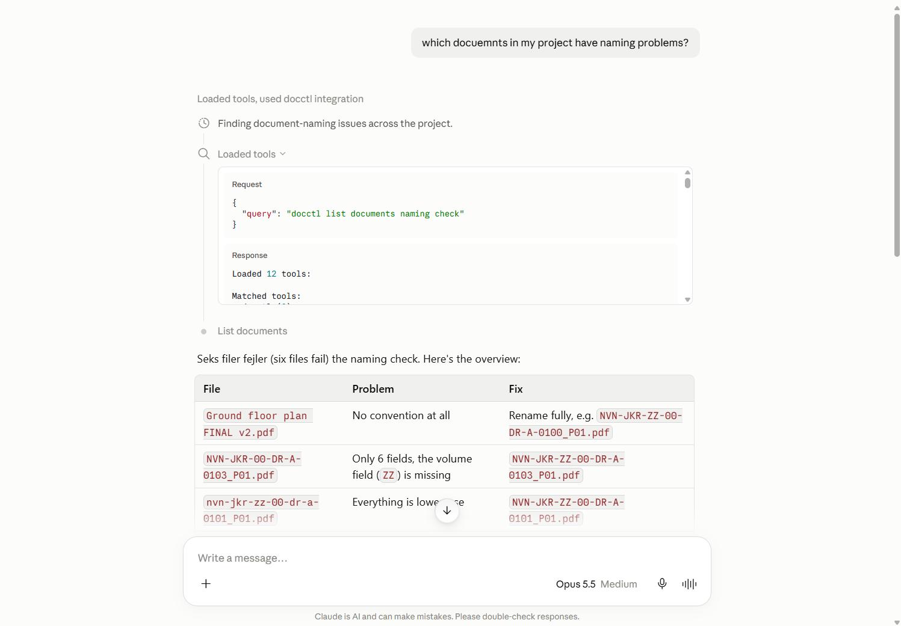
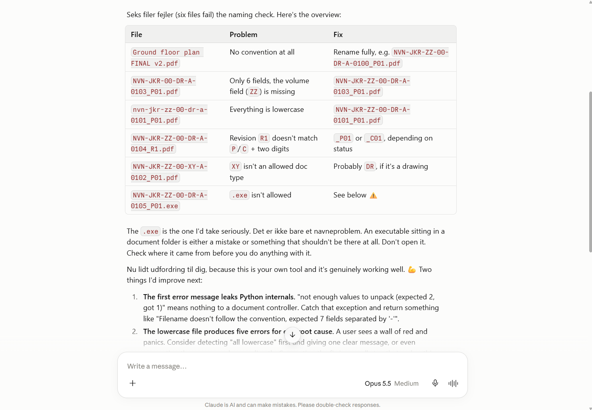
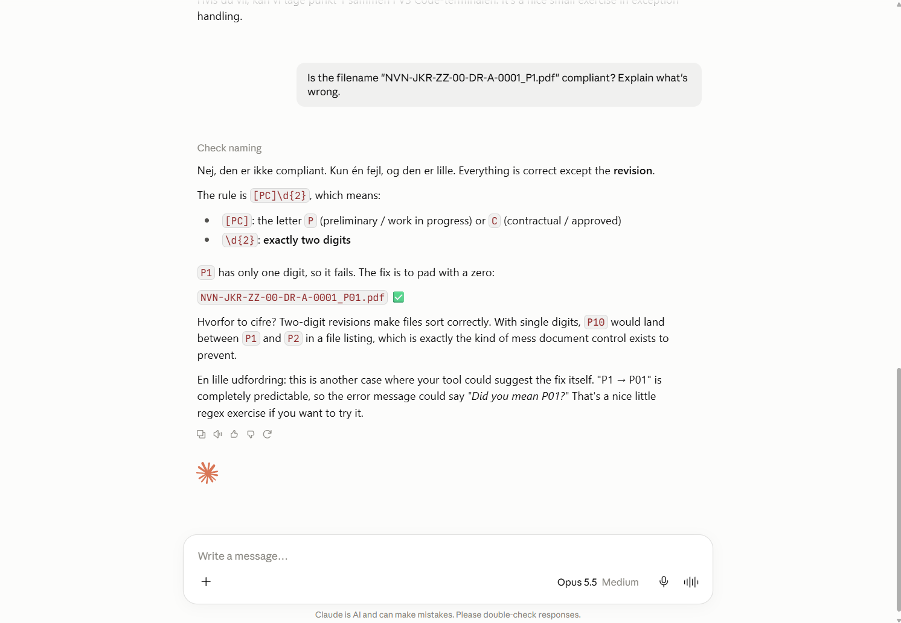
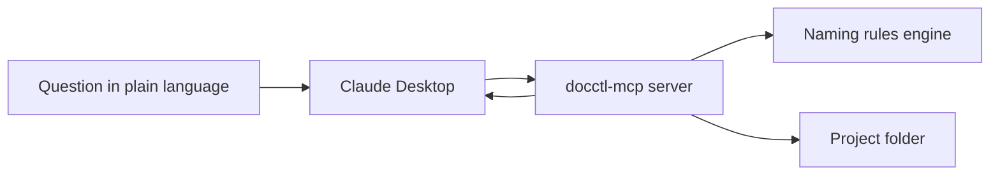

# docctl-mcp

**An AI document controller for construction projects.**
An MCP server that audits a project folder against ISO 19650-style naming rules, so you can ask Claude in plain language: *"Which documents have naming problems?"*

Built in Python, runs fully locally, no cloud costs.

## Demo

Claude Desktop picks the right tool by itself, runs my code on the real project folder, and explains the results:







## The problem

On construction and engineering projects, document control eats hours. Files get named wrong, the register says `P01` while the file is `P02`, and drawings exist that nobody registered. Document controllers usually check this by hand.

## How it works



- **`naming.py`** holds the rules engine. The naming standard lives in rule tables (configuration), and the code just applies them. Change the standard by editing the tables, not the logic.
- **`server.py`** exposes that logic to AI clients through the Model Context Protocol (MCP).
- Claude decides when to call which tool, based on the tool descriptions.

### Naming convention (simplified ISO 19650)

`NVN-JKR-ZZ-00-DR-A-0001_P01.pdf` = Project - Originator - Volume - Level - Type - Role - Number _ Revision . Extension

### MCP tools

| Tool | What it does |
| --- | --- |
| `list_documents` | Lists all documents in the project folder with their naming check result, optionally only the problems |
| `check_naming` | Checks one filename and explains exactly which field is wrong |

## Quickstart

Requires [uv](https://docs.astral.sh/uv/).

```bash
git clone https://github.com/justkmode/docctl-mcp.git
cd docctl-mcp
uv sync
uv run python scripts/generate_sample.py   # creates a fake project with 21 files
uv run pytest                              # runs the test suite
```

### Connect to Claude Desktop

In Claude Desktop, go to **Settings → Developer → Edit config** and add:

```json
{
  "mcpServers": {
    "docctl": {
      "command": "uv",
      "args": ["--directory", "PATH/TO/docctl-mcp", "run", "python", "-m", "docctl_mcp.server"]
    }
  }
}
```

Restart Claude Desktop and ask: *"Which documents in my project have naming problems?"*

## Project structure

```
docctl-mcp/
├── src/docctl_mcp/
│   ├── naming.py      # naming rules engine
│   └── server.py      # MCP server
├── tests/             # pytest test suite
├── scripts/           # sample project generator
└── sample_project/    # fake project folder + document register
```

## Roadmap

- [x] Naming rules engine with tests
- [x] Sample project with deliberately broken files
- [x] MCP server working in Claude Desktop
- [ ] Compare folder against the document register (missing files, revision mismatches)
- [ ] Audit report export
- [ ] Local AI agent using Ollama, fully offline
- [ ] Friendlier error messages with fix suggestions ("Did you mean P01?")
- [ ] CI with GitHub Actions
- [ ] Scheduled audits with n8n

## Tech

Python 3.12 · MCP Python SDK v2 · uv · pytest · ruff

## About

Built by [Justyna Krokowska](https://github.com/justkmode), Cloud & Automation Engineer, as a bridge between document control in construction and AI-powered automation.