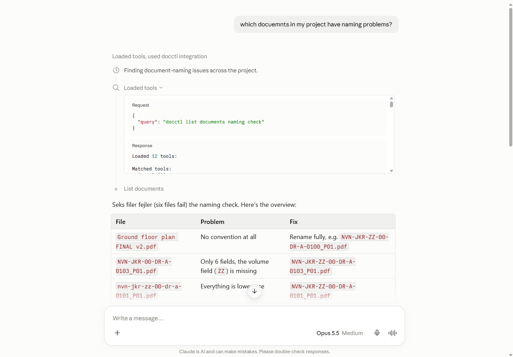
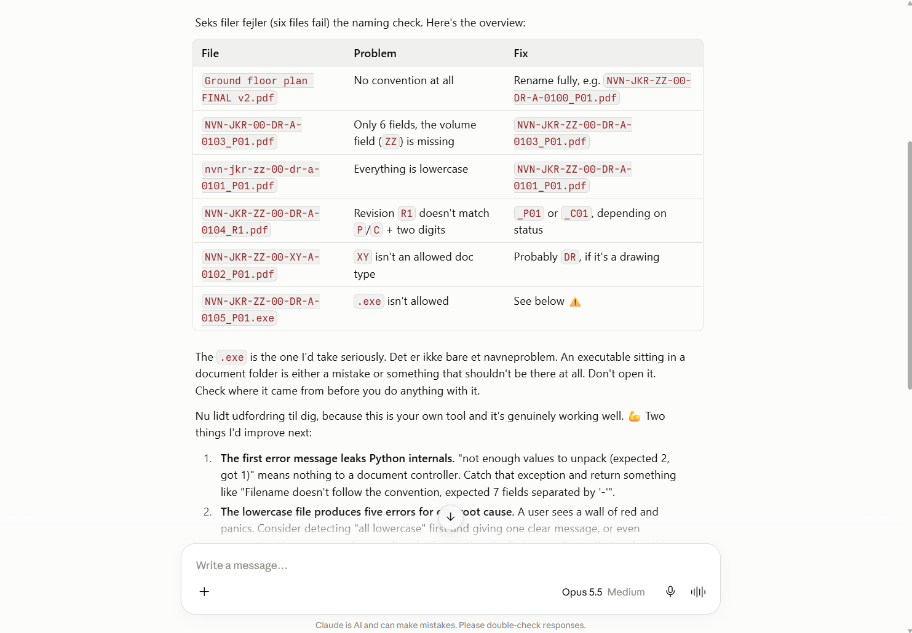
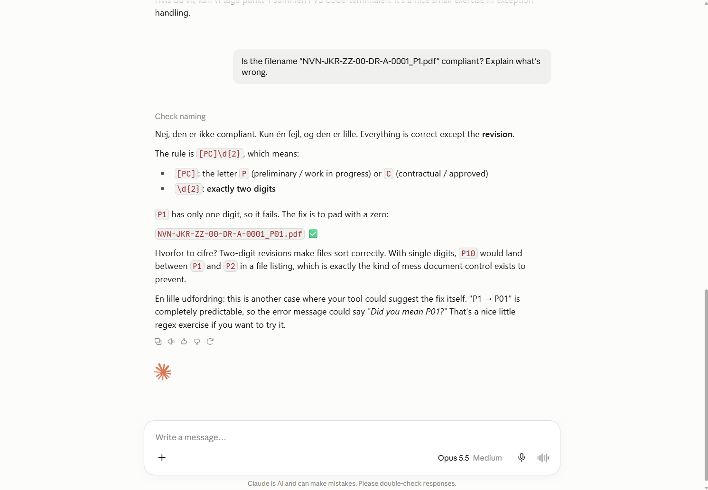
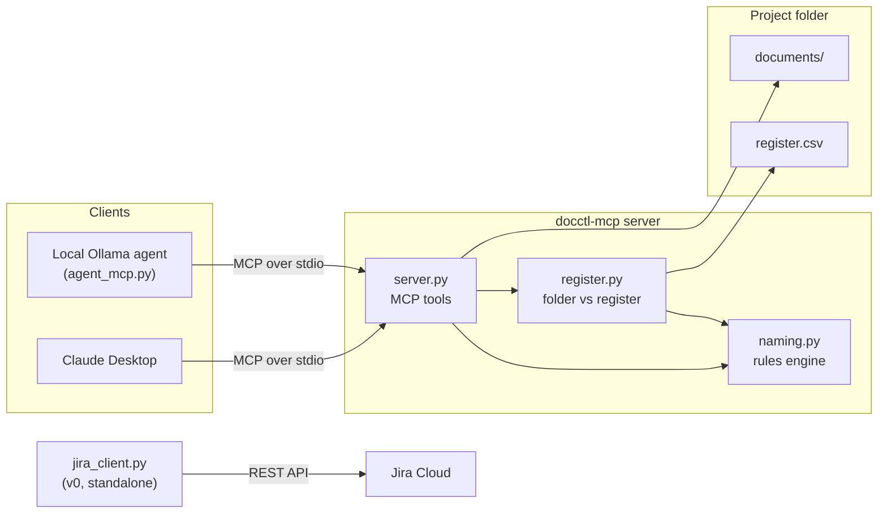

# docctl-mcp

[](https://github.com/justkmode/docctl-mcp/actions/workflows/ci.yml)

**An AI document controller for construction projects.**
docctl-mcp checks a project folder against ISO 19650 naming rules and the document register. It runs as an MCP server, so you can ask an AI assistant in plain language: *"Which documents have problems?"*

Python · runs locally · no paid services.

## The problem

On construction projects, document control is mostly manual work. A document controller checks hundreds of files by hand:

- **Wrong names:** `Ground floor plan FINAL v2.pdf` instead of `NVN-JKR-ZZ-00-DR-A-0001_P01.pdf`
- **Unregistered files:** a drawing is in the folder, but nobody added it to the register
- **Missing files:** the register lists a drawing that isn't in the folder
- **Revision mismatches:** the register says `P01`, the file says `P02`, and someone builds from the wrong drawing

These mistakes are easy to make, slow to find and expensive on site.

## What it does

docctl-mcp automates these checks and lets AI assistants use them as tools:

1. **Checks names** against the ISO 19650-style convention and explains exactly which field is wrong.
2. **Compares the folder with the register** and finds unregistered files, missing files and revision mismatches.
3. **Gives the results to an AI client** (Claude Desktop or a local Ollama model), which picks the right tool and explains the answer in plain language.

The naming convention:

```
NVN-JKR-ZZ-00-DR-A-0001_P01.pdf
Project-Originator-Volume-Level-Type-Role-Number_Revision.Extension
```

## Demo

Claude Desktop chooses the tool, runs it against the project folder and explains the result:







## Architecture



The code has three layers, each with one job:

- **`naming.py`: rules engine.** The naming standard is stored as data (regex patterns and lists of allowed values), not code. To change the standard, you edit the tables, not the logic.
- **`register.py`: reconciliation.** Compares the filenames in the folder with the register CSV. It reuses the parser from `naming.py` and doesn't write its own.
- **`server.py`: MCP interface.** Makes the checks available to any MCP client. The AI decides which tool to call by reading the tool descriptions.

## MCP tools

| Tool | What it does |
| --- | --- |
| `check_naming` | Checks one filename and lists every field that breaks the convention |
| `list_documents` | Lists all documents in the folder with their naming result (optionally only the problems) |
| `audit_folder` | Full audit in one call: naming problems, files not in the register, register entries without a file, and revision mismatches |

## How to run it

Requires [uv](https://docs.astral.sh/uv/). Run all commands from the repo root.

```bash
git clone https://github.com/justkmode/docctl-mcp.git
cd docctl-mcp
uv sync                                  # install dependencies
uv run python -m docctl_mcp.server       # start the MCP server (stdio)
uv run python scripts/check_folder.py    # quick naming check, no AI needed
```

The repo includes a sample project (`sample_project/`) with 21 files and a register. Some problems are planted on purpose: lowercase names, an unknown document type, a missing field, a wrong revision format, an `.exe` file and an unregistered drawing.

**Claude Desktop:** go to *Settings → Developer → Edit config* and add:

```json
{
  "mcpServers": {
    "docctl": {
      "command": "uv",
      "args": ["--directory", "PATH/TO/docctl-mcp", "run", "python", "-m", "docctl_mcp.server"]
    }
  }
}
```

**Fully offline with Ollama:** run `ollama serve` with the `qwen2.5:3b` model pulled, then:

```bash
uv run python scripts/agent_mcp.py
```

This agent starts the server as a real MCP client, converts the tools into Ollama's function-calling format and answers from the results.

## Tests and CI

```bash
uv run pytest           # test suite (naming rules + register reconciliation)
uv run ruff check .     # lint
```

GitHub Actions runs `uv sync --locked`, `ruff` and `pytest` on every push and pull request (`.github/workflows/ci.yml`).

## Jira integration (v0)

`scripts/jira_client.py` is a first step towards turning audit results into tickets. It creates one Jira issue through the REST API, using basic auth with an API token.

Credentials are read from a local `.env` file, which git ignores:

```
JIRA_URL=https://your-site.atlassian.net
JIRA_EMAIL=you@example.com
JIRA_API_TOKEN=...
```

```bash
uv run python scripts/jira_client.py     # prints 201 and the new issue key
```

v0 is a proof of connection. Every run creates a new issue, which v1 will fix.

## Roadmap

- [x] Naming rules engine with tests
- [x] Folder vs register reconciliation (`audit_folder`)
- [x] MCP server working in Claude Desktop
- [x] Local Ollama agent over MCP, fully offline
- [x] CI with GitHub Actions
- [x] Jira v0: create an issue via REST API
- [ ] **Jira v1, idempotent:** search for an open issue first and only create one if none exists, so repeated audits don't make duplicate tickets
- [ ] **n8n scheduled audit:** run `audit_folder` every night and write the results to Notion and Jira
- [ ] **Model evaluation:** compare local models (Ollama + Hugging Face) on choosing the right tool and getting the answer right

## Tech

Python 3.12 · MCP Python SDK v2 · uv · pytest · ruff · GitHub Actions · Ollama · Jira REST API

## About

Built by [Justyna Krokowska](https://github.com/justkmode), Cloud & Automation Engineer, as a bridge between document control in construction and AI-powered automation.
